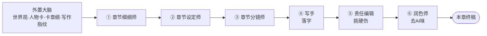
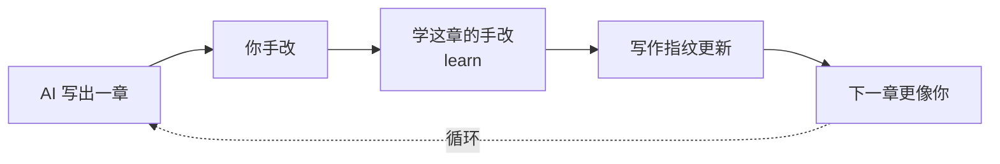
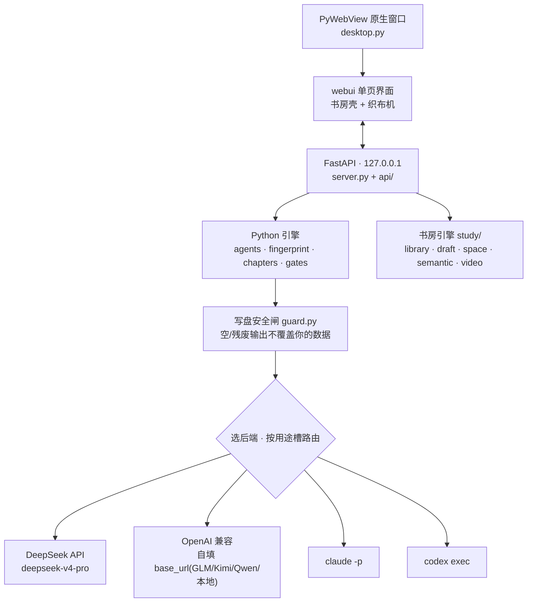

<div align="center">

<picture>
  <source media="(prefers-color-scheme: dark)" srcset="docs/design/loom-logo-dark.png" />
  
</picture>

# loom · 织布机

**把一队分工 Agent 织成一条写小说的流水线**,外面套一间**书房**:读书、取稿、攒资料、答疑,再点某本书进织布机开写。桌面客户端(Mac / Windows)。<br/>
读着你的「外置大脑」,一键跑出一章正文;你手改,它**越写越像你**。

[](LICENSE)
[](https://github.com/Twins2One/loom-mux/releases/latest)


[⬇ 下载最新版](https://github.com/Twins2One/loom-mux/releases/latest) · [它是什么](#它是什么) · [书房](#书房先读再写) · [织布机](#织布机六道工序出稿) · [里面有什么](#里面有什么) · [跑起来](#跑起来) · [隐私](#隐私--数据去向) · [交流](#反馈--交流)

</div>

---

> 本项目基于 [WadeZhao23/loom-novel](https://github.com/WadeZhao23/loom-novel)（MIT）重构；0.6.4 起按个人需求重构了 Loom-mux。

> 后端可插拔:**DeepSeek(默认)/ 智谱 GLM / Moonshot Kimi / 通义 Qwen / 豆包(火山方舟)/ 硅基流动**(国产直连、不用梯子、各家自带 key)/ **Claude Code / Codex**(复用本机客户端登录、免 key)/ **OpenAI 兼容(自填 base_url)**。设置里一键切换 + 检测连接;模型**可下拉可手填** + 「拉取可用模型」实时列真实型号。**每个流程可以单独选模型**(按用途分槽,见下)。

## 它是什么

- **书房**(外层壳):启动先落书房,点某本书才进织布机。书房里有三个常驻角色——**知识顾问**(取稿/读视频/整理笔记)、**语料分析师**(量文风/拆语料)、**书房伙伴**(答疑启发、不代笔)。
- **织布机**(书内):6 道工序出稿 + 8 人「作者智库」随时能叫来问话。
- **外置大脑**(每本书独有、会变):世界观 / 人物卡 / 卡章纲 / 立项卡 / 文风参考 / 状态账本 / **写作指纹** / 违禁词。可手填,也可 AI 一键铺底稿、就地改写续写。
- **skills**(跨书复用、不变):网文大神 / 去AI味 / 故事引擎 / 黄金开篇 / 评估自检 / 世界观引擎 / 金手指 / 拆书,外加 **52 个题材速查**(新建时按题材只拷那一份给设定师)。

## 书房:先读,再写

书房不是"新建一本书"的表单,它是一间能待着的地方。

- **取稿**:贴一支 B 站视频地址,它把字幕/转写/画面文字取回来。走四步:**① 选视频 → ② 取稿(地址取稿会访问 B 站,本地字幕文件不花钱) → ③ 理解(模型整理,一次调用) → ④ 沉淀**(写进个人图书馆,重名不覆盖)。
- **读稿**:正文、教材、素材都能在书房里浏览;语义检索能翻到"差不多意思"的段落(不是只会字面匹配)。
- **答疑**:书房伙伴回答你的"怎么写"类问题——只启发,**不代笔**,也不会偷偷往你书里写东西。


## 织布机:六道工序出稿



6 道工序顺序跑,累积一个「本章工作区」,每步读到目前为止的全部产物;写第 N 章还会读你手改后的第 N-1 章做衔接。

|  |  |  |
|:--:|:--:|:--:|
|  |  |  |
| **章节设定师** · 立规矩 | **章节细纲师** · 拆章 | **写手** · 落字 |
| 守世界观,钉死硬约束 | 这一章要怎么走 | 照你的写作指纹落字 |
|  |  |  |
| **责任编辑** · 挑硬伤 | **润色师** · 去AI味 |  |
| 盘爽点/钩子/OOC | 擦机器腔,留你的口头禅 |  |

### 作者智库:8 个人,随时叫

书内还有一个「讨论组」——**设定师 / 大纲师 / 战斗设计师 / 情绪节奏设计师 / 人物侧写师 / 编辑总监 / 批评家 / 市场分析师**。
一句话能同时派给几位同事各自看一遍,**谁在跑、谁和谁意见相反,一眼能看到**;每张候选卡右上角带提交人头像。它们的产出**也是候选卡**,你点了「落库」才进设定集。

### 两条核心理念

- **写作指纹 = 像你**。写手/润色师照它写;你点「学这章的手改」,它把**你的改动**蒸馏进指纹,越写越像你。指纹只学你的改动,绝不学 AI 自己的输出。
- **去AI味 = 独立功能**,只擦通用机器味、让文字像真人——不针对任何检测器作弊。



## 里面有什么

- **不丢稿**:所有写盘原子化(断电/崩溃不截成半截),每章覆盖前留版本历史,删章进回收站可恢复;写章 / learn / 保存各有写锁,并发不写坏账本。
- **长篇不崩**:**脉络三视图**(时间轴 / 伏笔账本 / 专名册,全书只读投影);**跨章除虫闭环**——每章写完自动查五类跨章矛盾(物品复活 / 人设跌份 / 金手指规则数值漂 / 时间粒度 / 衔接冲突)+ **状态账本**逐章记状态;**硬设定逐字直送**(境界阶梯 / 金手指代价 / 地名势力 / 人物专名整段原文送大纲师和写手,不经转述走样);伏笔埋久没还会提醒。
- **越写越像你**:写作指纹只学你的手改、绝不学 AI 输出;去AI味两道本地检测先过你的 anchor 豁免再进关卡;可从欣赏的作者范文播种「起点」,但开局像他、终局收敛到你。
- **看得见它有多懂你**:侧栏「**镜台**」一屏——**每章手改量的两条曲线**(改写率=它像不像你 / 增删率=它懂不懂你要什么)、写作指纹的规则与 anchor 原句、它跟你学到的写法。曲线只画你 learn 过的章。
- **外置大脑目录化**:世界观一节一文件、人物一人一卡(文件名即专名);learn 的 AI 补充单独进「成长档案」,永不碰你手写的;「冰山真相」按文件名挡住不喂写手,防提前剧透。
- **每个流程单独选模型**:设置里有一套**用途槽表**——写手 / 写作(改稿) / 大纲 / 审稿 / 长上下文检索 / 文风学习 / 深度逻辑推理 / 摘要 / 对话 / 知识顾问,每一格都能单独选 provider + model,不选就「跟随默认」。**可以给写正文配大模型、给摘要和自检配便宜模型**,互不牵连。
- **卡点了才落库**:AI 提的设定/教材/素材先是候选卡,你点「落库」才写进盘;卡在落库前会自己再复检一次(模型说卡里还有杂话就截掉,其余一个字不动);连点几张卡不会报「已过期」。
- **字数尽量听话**:大纲按目标字数定场次并给每场标字数,写手写满即收,编辑/润色拿到原稿实测字数、超了才压回来(合格稿不瞎压)、绝不扩写。诚实说:AI 没法边写边精确数字数,单章仍有 ±25-30% 波动,那是模型天花板。
- **接入灵活 · 本地优先**:九选一后端(国产六家直连 / Claude·Codex 免 key / OpenAI 兼容自填 base_url),可下拉可手填、拉取真实型号;稿子只在你磁盘,**Loom 无服务器、无遥测、无账号**。

## 更新记录

> 公开版本从 **0.3.3** 起、以诚实的早期 0.x 重新计数。更早出现过的 1.x–3.x 是重置前的内部开发编号,已不再对应任何发布。
> 下面只列**影响你手感**的几版;逐版细账在 `docs/更新日志-*.md`。

### 0.8.13 · 记忆抢救不再堆桌面
「导出记忆数据」原来每次都在**桌面**新建一个文件夹、从不清理;现在跟着知识库走,**只保留最近 16 次**,更早的自动收尾。另修设置面板一批文案与两处死路(首启弹层「用新位置」点了必失败、切到空目录的警告 600 毫秒就关层)。

### 0.8.12 · 分块蒸馏 + 记忆库维护 + 智库补到 8 人
接在 0.8.10 后面十天的改动都挂在这个号上:分块蒸馏可多块并行、记忆库体检与抢救、几处发布链路修正;**市场分析师**(第 7 人)与**人物侧写师**(第 8 人)在这十天里补齐,智库从 6 人变 8 人。

### 0.8.10 · 账户壳 + 四档模式 + 使用向导
登录页/注册/无密码账户;「AI思考强度」四档;**新用户第一次打开有向导带你转一圈**(真模型对话流,不是静态说明)。

### 0.8.8 · 三档 AI 思考强度
**主动思考 / 默认 / 安静**三档——同一句话,它愿意谈多久、什么时候出卡,由你定。

### 0.8.6 · 工具调用全英文
修中转商对中文工具名拒收;书房伙伴的原生 function calling 从「上线以来零成功」修到全链路通。

### 0.8.4 · 取稿进包
B 站取稿收进包内(不再需要你装 Python);作者智库精简成 6 人(知识顾问与语料分析师的功能变成工具、让所有智能体都能调);查资料和量文风变成通用工具;书架改书封网格。

### 0.8.3 · 语义检索进安装版
语义检索真进了安装版(不再是"只在开发目录里跑得通");读书时可以边读边记、笔记能被搜出来;取稿链从开发目录搬进 Loom 自己的目录。

### 0.8.0 · 书房
**在原 Loom-mux 外面加了一层壳**:启动先落在书房,点某本书才进织布机。

### 0.7.2 · 议事厅
说一件事,几位同事同时各自看一遍,分歧点摊在桌面上。

### 0.6.3 → 0.6.7 · 角色注入不再改你书里的 md
凡"角色行为"类改动一律走代码注入,**旧书立即生效**,不需要改你书里那份 `agents/*.md`。

### 0.5.1 · 学改法这回真的能学了
上一版把「AI 交的细纲」和「你改成的」两份原文整个丢给模型自己比——两份各一千多字、真正的差异只有一两行,它找不着。这版**先由程序把差异逐行算出来**再交给它。真机实测:改前回「无」,改后当场归纳出两条习惯。同一个模型、同一批稿子。

### 0.5.0 · 镜台 + 它开始跟你学改法
侧栏多了「**镜台**」:**改写率**和**增删率**两条曲线,加上写作指纹学到了几条规则、它认的 anchor 原句。曲线只画你 learn 过的章——没 learn 的不算 0%,那是「还没看」不是「不用改」。

### 0.4.x · 修装不上、修除虫、伙伴会聊天
0.4.4 修 8 月 12 日 openai 3.0 大版本导致的「全新安装起不来」;0.4.3 修除虫的四个 bug(对照的永远是第一章、一条判据恒成立、两次跑证据不一致);0.4.0 伙伴不再让你一格格填空,而是直接跟你聊。

## 拿到它

- **网文作者(不写代码)**:去 [Releases](https://github.com/Twins2One/loom-mux/releases/latest) 下载**当前版本那个 zip**(资产名带版本号,如 `Loom-mux-v0.8.13-win.zip`)→ 解压 → **Windows** 双击,SmartScreen 蓝框时点「更多信息 → 仍要运行」。**Mac 包目前还没有出**(CI 的 mac 那一棒尚未跑通),Mac 用户请先走下面「从源码跑」。
- **开发者 / 从源码跑**:见下「跑起来」。

## 跑起来

```bash
pip install -e .          # 装好后有三个入口
loom-app                  # ① 桌面客户端(原生窗口)—— 推荐
loom-serve                # ② 兜底:在浏览器里跑(pywebview 出问题时用)
loom                      # ③ 内部引擎调试 CLI(开发用,非产品)
```

打开后:**书房**落页 → 想取稿就贴视频地址、想读书就点书 → **新建一本书** → 顶栏选后端、填 DeepSeek API Key(`platform.deepseek.com` 申请)→ 外置大脑可**一键起草初稿**(或自己填)→ **写第 1 章**(看 6 道工序依次点亮)→ 在编辑器里手改 → **学这章的手改**(指纹更新,越来越像你)。

- 用 Claude Code / Codex 当后端时,顶栏切 provider 即可,**无需在 Loom 填 key**:Loom 直接 shell 到本机 `claude -p` / `codex exec`,复用它们各自客户端的登录(含订阅)。前提是已装好 `claude` / `codex` 命令并登录过(`codex login`)。

## 三个大件（不随仓库）

`loom/vendor/` 里有两个必须随包走的小件（`bili-vision/bv.py`、`embed/tokenizer.json`），但**三个大件不放进仓库**：语义检索的向量模型、`ffmpeg.exe`、`ffprobe.exe`（合计约 550 MB）。

**缺了程序不会报错，但质量会下降**：没有向量模型时语义检索退化成关键词/字面匹配；没有 ffmpeg / ffprobe 时视频只能走纯文字（字幕/转写），看不了画面。

ffmpeg / ffprobe 可由脚本获取并校验（已存在且相符则跳过）：

```bash
python -m loom.vendor.fetch_vendor --only ffmpeg
```

`embed/model.onnx` **没有官方下载地址**（它是本地从 BAAI/bge-large-zh-v1.5 导出的 ONNX），
所以脚本不会替你下载它：缺这一件时请按 `loom/vendor/README.md` 的「方案 B」本地导出，
或放置一份自己核验过的文件。空 URL 时脚本会明确返回未就绪，不会伪造地址。

详细说明（三个文件是什么、从哪拿、放哪、如何手工校验）见 **[`loom/vendor/README.md`](loom/vendor/README.md)**。

## 隐私 / 数据去向

Loom 没有服务器、没有遥测、没有账号——**Loom 自身不收集、不上传任何东西**。

- **你的书全在本地**:正文 / 外置大脑 / 写作指纹 / 版本历史 / 备份 / 教材 / 素材,都存在你磁盘上的项目文件夹里。
- **AI 生成会把上下文发给你选的模型**(任何 AI 写作工具都绕不开):写一章时,世界观 / 人物卡 / 卡章纲 / 写作指纹 / 上一章 + 你的指令会发给——
  - **DeepSeek**:DeepSeek 云端 API(用你自己的 key);
  - **Claude Code / Codex**:经你本机的 `claude` / `codex` 客户端 → Anthropic / OpenAI;
  - **本地模型 / 自填 base_url**:只发到你自己填的那个地址。

  Loom 只是把内容交给它们生成,不额外留存、不中转、不旁路上传。
- **取稿会外发到 B 站**:只有你点「取稿」才会连,一次调用 = 一次外发;B 站凭据只在本机、不回显明文。
- **key**:DeepSeek key 明文存在项目里的 `.env`——别把含 `.env` 的项目整包发别人;「备份整本」生成的 zip **不含 .env**,拷走是安全的。Claude / Codex 复用客户端登录,Loom 不碰它们的 key。

## 架构(为什么这么搭)

纯 Python 引擎(`loom/`:backends / agents / fingerprint / chapters / gates / fsutil / study)→ 本地 FastAPI(`server.py` + `api/`,只听 127.0.0.1)→ Web 单页界面(`webui/` + `webui/study/`)→ PyWebView 套原生窗口(`desktop.py`)。引擎跨平台、与界面解耦(进度走事件回调),Windows 复用 ≈95%,只需重打包。详见 [docs/adr/0004](docs/adr/0004-desktop-client-pywebview.md)。



## 设计记录

词表见 [`CONTEXT.md`](CONTEXT.md)(仓库根目录的术语表,定义"外置大脑 / 立项卡 / skills / 写作指纹"这些词到底指什么),关键决定见 [docs/adr/](docs/adr/)(指纹为什么是活的、为什么只学你的改动、为什么不绑检测分数、为什么做成桌面端)。

## 反馈 · 交流

Loom 还在早期,写得不够好的地方欢迎直说。有问题、想反馈,或想聊聊网文 + AI 写作,欢迎在 [Issues](https://github.com/Twins2One/loom-mux/issues) 里提。

## License & 素材

[MIT](LICENSE) Copyright (c) 2026 Chambers；项目署名 Two2One。基于 [WadeZhao23/loom-novel](https://github.com/WadeZhao23/loom-novel)（MIT）重构。

除市场分析师外，agent 角色头像由 [ModelScope](https://modelscope.cn) 的 Qwen-Image 生成；市场分析师头像由本项目使用 Pillow 在本地程序化绘制。上述头像随本仓库以 MIT 分发。
